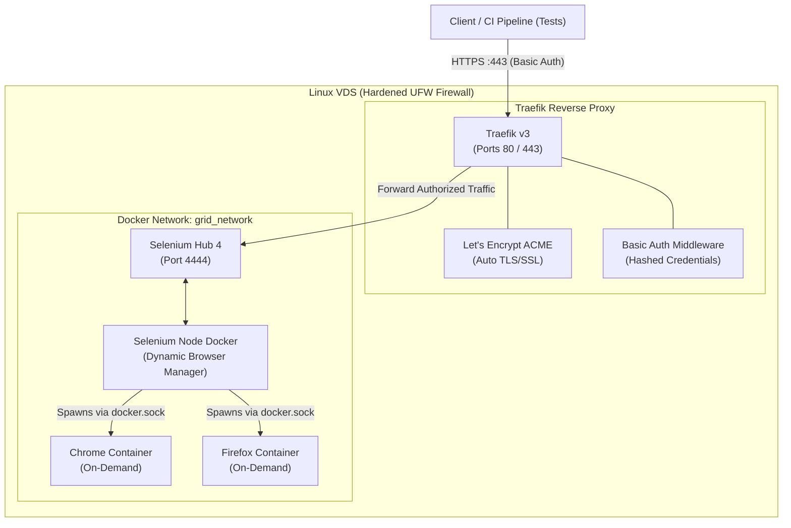

# Selenium Grid 4 Secure Deployment Role

[](https://github.com/AndreyJVM/ansible-role-selenium-grid/actions/workflows/ci.yml)
[](https://galaxy.ansible.com/AndreyJVM/selenium_grid_secure)
[](https://opensource.org/licenses/MIT)

> [!IMPORTANT]
> **Security First.** Many repositories offer quick scripts to deploy Selenium Grid. However, if real security matters to you (closed ports, no root access, mandatory Basic Auth, and automated Let's Encrypt certificates for HTTPS) — **you are in the right place**. The entire infrastructure is deployed automatically, leaving no backdoors for bots or cryptominers.

An Ansible Role that automates the deployment of a highly scalable **Selenium Grid 4** environment on a fresh Linux VDS. It configures the server, secures it, installs Docker, and launches the Grid behind a **Traefik Reverse Proxy**.

## Table of Contents
- [Features](#features)
- [Architecture](#architecture)
- [Requirements](#requirements)
- [Quick Start (Copy-Paste)](#quick-start-copy-paste)
- [Verification](#verification)
- [Role Variables](#role-variables)
- [Advanced Configuration](#advanced-configuration)
- [Updating the Grid](#updating-the-grid)
- [Proxmox VE: Provision with Terraform](#proxmox-ve-provision-with-terraform)
- [Selectel Cloud: Provision with Terraform](#selectel-cloud-provision-with-terraform)
- [Testing the Role (Testcontainers & CI)](#testing-the-role-testcontainers--ci)
- [Integration with Java (WebDriver Factory)](#integration-with-java-webdriver-factory)

## Features

- **Selenium Grid 4 (Router + Nodes):** Modern implementation of Selenium Grid, ready for scaling.
- **Traefik (Reverse Proxy):** Provides routing and HTTPS for secure operation.
- **Let's Encrypt:** Traefik automatically generates and renews valid SSL/TLS certificates.
- **Basic Auth:** Mandatory authentication for accessing the Grid nodes.
- **Server Initialization:** Automatically sets up the VDS (creates a non-root `deployer` user, installs Docker, configures UFW firewall, secures SSH by disabling root login and password auth, generates `htpasswd`, and deploys the Grid).

## Architecture



## Requirements

Before running the playbook, ensure your server meets the following conditions:
- [x] **Clean OS:** Fresh installation of Ubuntu 22.04 LTS, Ubuntu 24.04 LTS, or Debian 12. No prior setup (Docker, Nginx, etc.) is required.
- [x] **SSH Access:** Your public SSH key is added to `/root/.ssh/authorized_keys`. You must be able to SSH into the server as `root` without a password from your local terminal.
- [x] **Configured DNS:** An `A` record points to the public IP address of this VDS (e.g., `selenium.my-domain.com`). *Wait for DNS propagation, otherwise Let's Encrypt will fail to issue the certificate!*
- [x] **Hardware:** Minimum 4 vCPU and 8 GB RAM (to comfortably run the hub and 3-4 parallel browser sessions).

## Quick Start (Copy-Paste)

This guide is designed for QA Automation Engineers. You don't need advanced DevOps skills! Just open your local Linux/macOS terminal and copy-paste the blocks below.

**1. Install Ansible (if you don't have it on your local machine)**
```bash
sudo apt update && sudo apt install -y ansible
```

**2. Download the role from Ansible Galaxy**
```bash
ansible-galaxy install AndreyJVM.selenium_grid_secure
```

**3. Create the deployment file**
Copy this entire block and paste it into your terminal, then press Enter. It will create a `deploy-grid.yml` file automatically:
```bash
cat << 'EOF' > deploy-grid.yml
---
- hosts: all
  become: yes
  vars_prompt:
    - name: basic_user
      prompt: "Enter Basic Auth Username for Selenium Grid"
      default: "admin"
      private: no
    - name: basic_password
      prompt: "Enter Basic Auth Password"
      private: yes
    - name: domain_name
      prompt: "Enter Domain Name (e.g. selenium.my-domain.com)"
      private: no
    - name: acme_email
      prompt: "Enter Email for Let's Encrypt SSL"
      private: no
  roles:
    - AndreyJVM.selenium_grid_secure
EOF
```

**4. Run the deployment**
Replace `192.168.1.100` with the actual IP address of your new server:
```bash
ansible-playbook -i "192.168.1.100," -u root deploy-grid.yml
```
*(⚠️ Note: Do not forget the comma `,` after the IP address!)*

**Done!** The script will ask you for the domain, email, and credentials, and then do all the magic. 

## Verification

Once deployment completes, verify that your Selenium Grid is operational:

**1. Web Console:**
Open `https://selenium.my-domain.com/ui` in your browser. Enter your Basic Auth credentials when prompted. You will see the Selenium Grid 4 Dashboard with ready browser nodes.

**2. API Healthcheck:**
Run a curl command to check the hub status:
```bash
curl -u admin:your_password https://selenium.my-domain.com/status
```
Expected response contains `"ready": true`.

## Role Variables

The following default variables are defined in [`defaults/main.yml`](defaults/main.yml) and can be overridden:

| Variable | Default Value | Description |
| :--- | :--- | :--- |
| `selenium_grid_deploy_user` | `"deployer"` | Non-root system user created for Docker and deployments |
| `selenium_grid_timezone` | `"UTC"` | Server system timezone |
| `selenium_grid_ssh_port` | `22` | SSH port configured on the host |
| `selenium_grid_project_path` | `"/opt/ui-tests-infra"` | Destination directory on the server for Grid files |
| `selenium_grid_http_port` | `"80"` | Host HTTP port for Let's Encrypt HTTP challenge & redirect |
| `selenium_grid_https_port` | `"443"` | Host HTTPS port for secure Selenium Grid entry |
| `selenium_grid_version` | `"4.20.0"` | Selenium Hub and Node Docker image version |
| `traefik_version` | `"v3.6"` | Traefik Reverse Proxy Docker image version |

Required variables prompted during deployment:
- `basic_user`: Username for Basic Authentication.
- `basic_password`: Password for Basic Authentication (will be hashed automatically).
- `domain_name`: Fully Qualified Domain Name (FQDN) pointing to the VDS IP.
- `acme_email`: Contact email for Let's Encrypt SSL certificate registration.

## Advanced Configuration

If you want to customize the deployment without interactive prompts, specify variables directly in your `deploy-grid.yml`:

```yaml
---
- hosts: all
  become: yes
  vars:
    basic_user: "qa_admin"
    basic_password: "SuperSecretPassword123!"
    domain_name: "selenium.my-domain.com"
    acme_email: "admin@my-domain.com"
    selenium_grid_project_path: "/opt/custom-grid"
    selenium_grid_version: "4.20.0"
    traefik_version: "v3.6"
  roles:
    - AndreyJVM.selenium_grid_secure
```

## Updating the Grid

If you manually modify the configuration files inside the role (e.g., adding new browser nodes to `docker-compose.yml`), you do not need to run the full server initialization again.

Use the `update` tag to quickly push configuration changes and restart the containers. Since `root` login is automatically disabled after the first run for security reasons, execute this as the `deployer` user:

```bash
ansible-playbook -i "192.168.1.100," -u deployer deploy-grid.yml --tags update
```

## Proxmox VE: Provision with Terraform

An automated **Terraform** module for on-premises **Proxmox VE 7 / 8** virtualization is available in [`examples/proxmox`](examples/proxmox). It uses the modern [`bpg/proxmox`](https://registry.terraform.io/providers/bpg/proxmox/latest) provider to clone an Ubuntu Cloud-Init template, configure 4 vCPU, 8 GB RAM, 30 GB storage, network, static IP, and SSH keys, and automatically generates an Ansible inventory file.

1. Navigate to the directory and copy the example variables:
   ```bash
   cd examples/proxmox
   cp terraform.tfvars.example terraform.tfvars
   ```
2. Configure your Proxmox endpoint, API token, node, template ID, and network settings in `terraform.tfvars`.
3. Provision the VM:
   ```bash
   terraform init
   terraform apply
   ```
4. Deploy the Selenium Grid role using the auto-generated inventory:
   ```bash
   ansible-playbook -i examples/proxmox/hosts.ini deploy-grid.yml
   ```

For detailed instructions, see [`examples/proxmox/README.md`](examples/proxmox/README.md).

## Selectel Cloud: Provision with Terraform

An automated **Terraform** configuration for **Selectel Cloud Platform (VPC)** is available in [`examples/selectel`](examples/selectel). It creates a complete private VPC, router, 30 GB fast NVMe boot volume, 4 vCPU / 8 GB RAM instance (`c4m8-d0`), attaches a public Floating IP, injects your SSH key, and generates an Ansible `hosts.ini` inventory automatically.

1. Install Terraform and navigate to the directory:
   ```bash
   cd examples/selectel
   cp terraform.tfvars.example terraform.tfvars
   ```
2. Fill in your Selectel credentials in `terraform.tfvars` (Account ID, Project UUID, and Service User password).
3. Apply the infrastructure:
   ```bash
   terraform init
   terraform apply
   ```
4. Run deployment using the auto-generated inventory:
   ```bash
   ansible-playbook -i examples/selectel/hosts.ini deploy-grid.yml
   ```

For detailed options and instructions, see [`examples/selectel/README.md`](examples/selectel/README.md).

## Testing the Role (Testcontainers & CI)

This repository includes automated infrastructure tests based on **Testcontainers** and **JUnit 5** located in [`src/test/java/infra/VdsSetupTest.java`](src/test/java/infra/VdsSetupTest.java). The test suite spins up isolated privileged Docker containers simulating clean OS installations (Ubuntu 22.04 LTS and Ubuntu 24.04 LTS), executes the Ansible role, and validates:
- Timezone configuration (UTC) & Chrony NTP service
- Creation of non-root `deployer` user with `sudo` and `docker` groups
- SSH hardening and authorized keys permissions (`0600`)
- Docker CLI installation and service readiness
- UFW firewall activation and rule configuration
- Selenium Grid 4 and Traefik configuration files deployment

To run the infrastructure tests locally:
```bash
mvn test
```

### Continuous Integration (GitHub Actions)

Every push and pull request triggers [`.github/workflows/ci.yml`](.github/workflows/ci.yml) consisting of:
1. **Linting & Syntax Check:** `yamllint` and `ansible-lint`.
2. **Terraform Format & Validation:** `terraform fmt -check` and `terraform validate` across both `examples/proxmox` and `examples/selectel` modules.
3. **DevSecOps Security Audit:** `aquasecurity/trivy-action` scanning configurations and filesystem for vulnerabilities.
4. **Integration Testing:** Execution of the full Testcontainers test suite on clean Ubuntu environments.

## Integration with Java (WebDriver Factory)

You do not need to copy this repository into your test automation projects. This infrastructure lives independently. In your Java project, simply implement a Factory pattern to manage your WebDriver.

Example `WebDriverFactory.java`:

```java
import org.openqa.selenium.WebDriver;
import org.openqa.selenium.chrome.ChromeDriver;
import org.openqa.selenium.chrome.ChromeOptions;
import org.openqa.selenium.remote.RemoteWebDriver;
import java.net.URI;

public class WebDriverFactory {
    public static WebDriver createDriver() {
        // Control execution via RUN_ON_GRID property
        boolean runOnGrid = Boolean.parseBoolean(System.getProperty("RUN_ON_GRID", "false"));

        if (runOnGrid) {
            // Connect to your secured infrastructure on the VDS
            ChromeOptions options = new ChromeOptions();
            String gridUrl = String.format("https://%s:%s@%s/wd/hub", 
                    System.getenv("GRID_USER"), 
                    System.getenv("GRID_PASS"), 
                    System.getenv("GRID_DOMAIN"));
            try {
                return new RemoteWebDriver(URI.create(gridUrl).toURL(), options);
            } catch (Exception e) { 
                throw new RuntimeException("Failed to connect to Remote Grid", e); 
            }
        } else {
            // Local execution for debugging
            return new ChromeDriver(); 
        }
    }
}
```

Run tests locally:
```bash
mvn test
```

Run tests in CI/CD pipeline on the remote server:
```bash
mvn test -DRUN_ON_GRID=true
```
